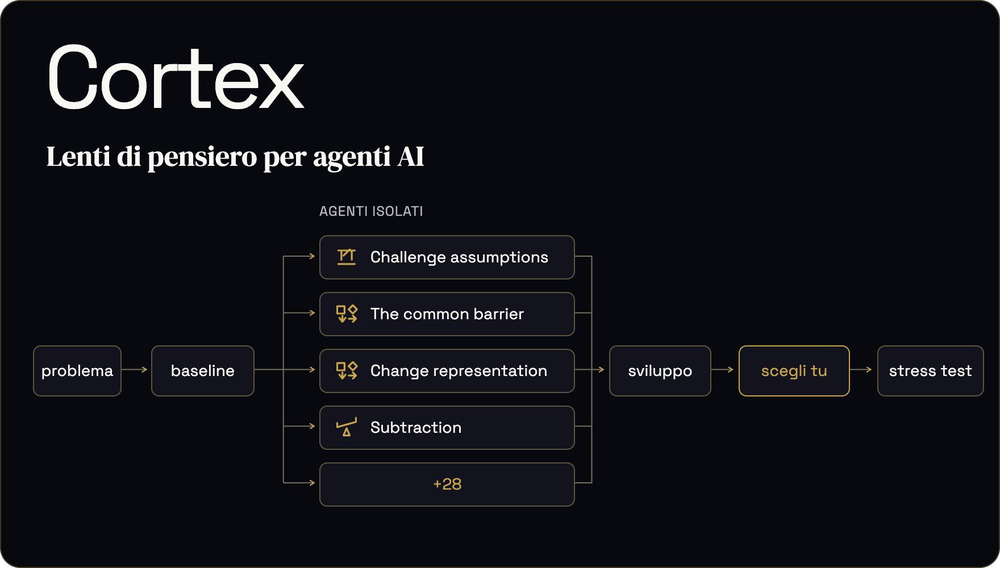
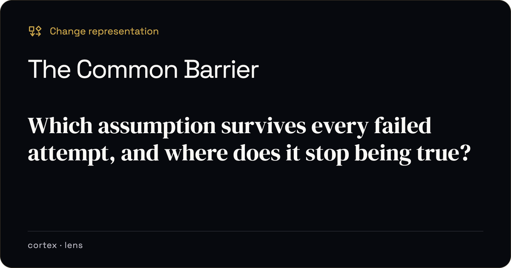
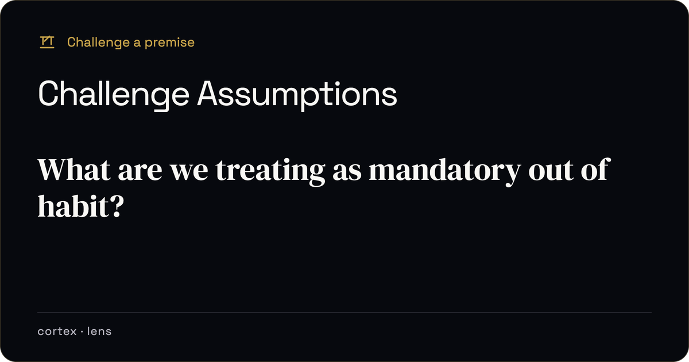
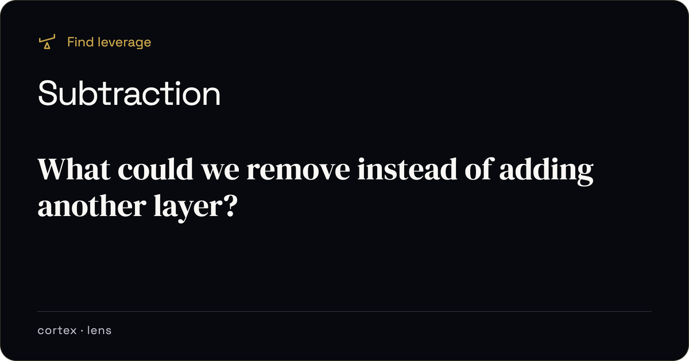
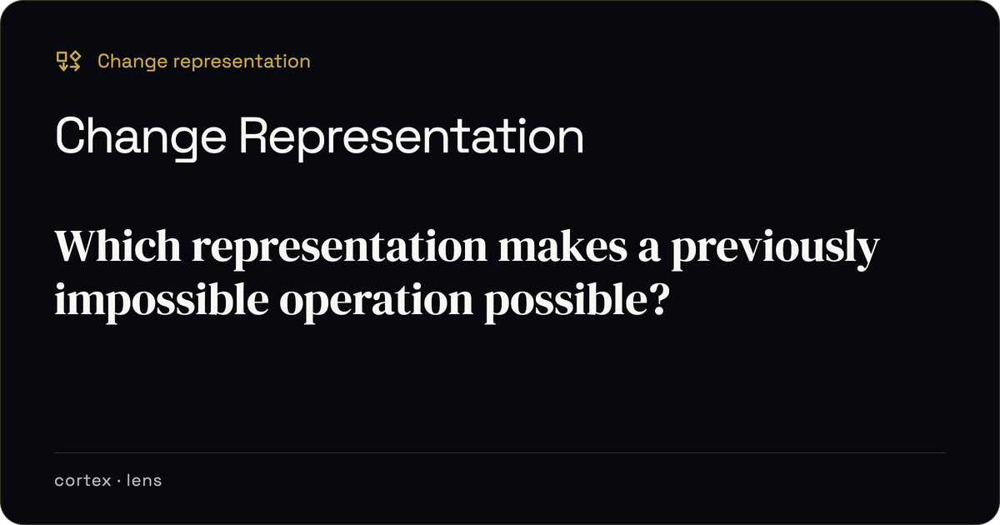
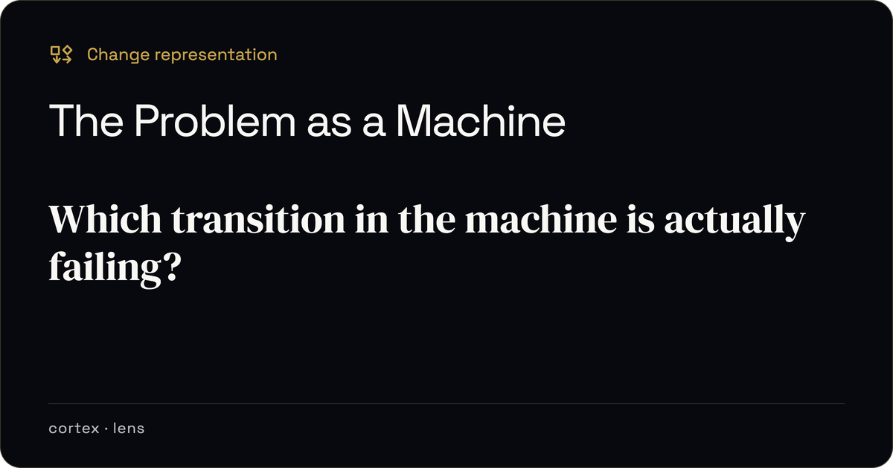
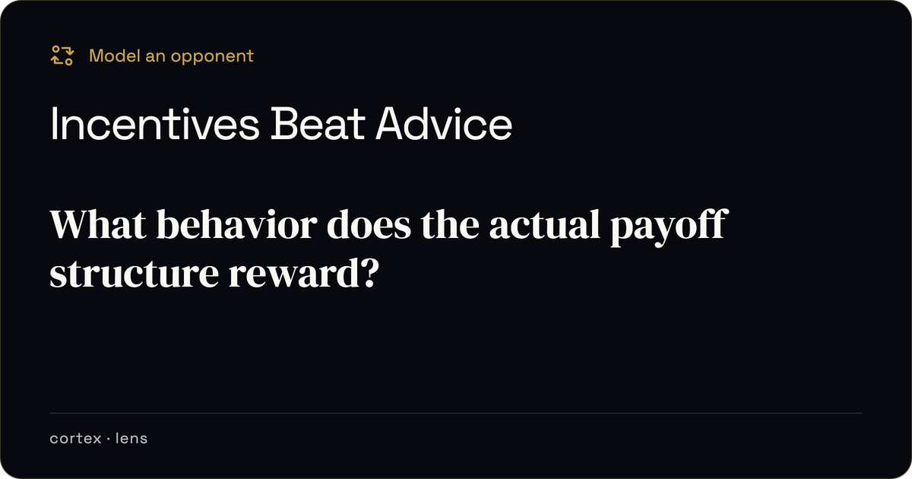
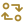
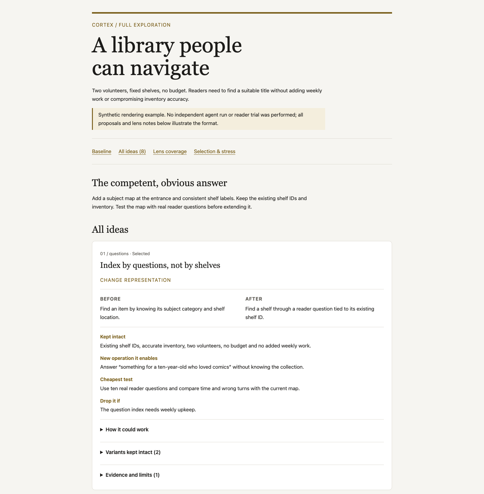

<p align="center">
  
</p>

<p align="center">
  
  
  
</p>

# Cortex: pensiero laterale per agenti AI

**La prima risposta del tuo agente di rado è sbagliata. Il guaio è che è l'unica che prende in considerazione.**

Cortex è una agent skill di pensiero laterale per Claude Code, Codex e OpenCode. Fa passare un problema difficile attraverso alcune *lenti di pensiero*, brevi procedure come «metti in dubbio la premessa» o «togli invece di aggiungere», applicate da agenti che non hanno mai visto la tua bozza; nella modalità completa ogni lente ha un agente isolato tutto per sé. Tornano indietro le idee capaci di cambiare la tua decisione, ognuna con la prova più economica in grado di smentirla.

Cortex fa parte del mio lavoro di ricerca al [DL Frontier Lab](https://danilolapegna.com/lab).

[English](README.md) · [Guida pratica](https://danilolapegna.com/guides/cortex-lenses-agent-skills-it) · [L'esperimento](https://danilolapegna.com/lab/cortex-decisioni-piu-lucide)

## Perché isolare le lenti

Se chiedi dieci idee in una sola conversazione, ottieni di solito la stessa idea vestita in dieci modi: ogni risposta si appoggia a quelle venute prima. Cortex sposta il punto di partenza, non le parole. Nella modalità completa ogni lente riceve un agente nuovo, che vede soltanto il problema e la propria procedura; le quattro lenti che lavorano trasformando una risposta vedono anche la baseline. Nella modalità rapida, invece, un solo agente che non ha mai visto la tua bozza applica da tre a cinque lenti.

Ne discendono tre scelte di progetto.

1. **Prima viene la baseline.** Nella modalità completa un agente separato scrive la risposta competente e ovvia. Ogni idea si misura con quella, e la domanda non è mai «è brillante?» ma «cambierebbe ciò che fai?».
2. **Una lente va a caccia dell'assunzione condivisa.** [La barriera comune](skills/cortex/lenses/the-common-barrier.md) legge la baseline e i tentativi falliti, trova l'assunzione che hanno tutti in comune e cerca la rappresentazione in cui smette di essere vera. Quando un problema continua a resistere, la via d'uscita sta spesso lì.
3. **Generare e giudicare sono momenti distinti.** Mentre le idee nascono, nessuna viene ordinata o scartata. Le vedi tutte in una pagina, e solo quelle che scegli passano allo stress test.

## Due modalità

| | Rapida | Completa |
|---|---|---|
| **Quando usarla** | Hai già una risposta e vuoi un secondo sguardo prima di impegnarti | La decisione conta, oppure il problema ha resistito a due tentativi |
| **Che cosa viene eseguito** | Da 3 a 5 lenti scelte per il problema, in un agente che non ha visto la tua bozza | Le 24 lenti principali più quelle adatte al caso, ciascuna in un agente separato; dove un'affermazione è decisiva, si controllano le fonti |
| **Che cosa ottieni** | La tua risposta diretta e, accanto, al massimo tre idee | Tutte le idee, sviluppate in proposte da provare, in una sola pagina |
| **Costo** | Una chiamata in più all'agente | Decine di chiamate: alcuni minuti e molti più token |

Basta chiederlo a parole: *«usa cortex quick su questo»* oppure *«fai un cortex completo su questa decisione»*.

## Alcune lenti

<p align="center">
  <a href="skills/cortex/lenses/the-common-barrier.md"></a>
  <a href="skills/cortex/lenses/challenge-assumptions.md"></a>
  <a href="skills/cortex/lenses/subtraction.md"></a>
  <a href="skills/cortex/lenses/change-representation.md"></a>
  <a href="skills/cortex/lenses/the-problem-as-a-machine.md"></a>
  <a href="skills/cortex/lenses/incentives-beat-advice.md"></a>
</p>

Le lenti sono 32, raccolte in undici famiglie. Non devi sceglierle tu, perché l'agente prende quelle adatte al problema; ciascuna è anche un breve file Markdown, in inglese, che puoi leggere come un manuale da campo o applicare a mano.

| | Famiglia | A che cosa serve | Per esempio |
|---|---|---|---|
|  | Riformulare | Riporta il problema al livello più utile | [Ladder of whys](skills/cortex/lenses/ladder-of-whys.md), la catena dei perché |
|  | Mettere in dubbio una premessa | Verifica ciò che tutti danno per scontato | [Remove the ritual](skills/cortex/lenses/remove-the-ritual.md), togliere il rituale |
|  | Trasferire un meccanismo | Prende una soluzione che funziona in un campo lontano | [The core verb](skills/cortex/lenses/the-core-verb.md), il verbo centrale |
|  | Cambiare rappresentazione | Dà al problema una forma che permette un'operazione nuova | [The problem as a machine](skills/cortex/lenses/the-problem-as-a-machine.md), il problema come macchina |
|  | Trovare la leva | Cerca il piccolo cambiamento con il grande effetto | [The ordinary fix](skills/cortex/lenses/the-ordinary-fix.md), la soluzione ordinaria |
|  | Generare | Produce molte opzioni in modo ordinato | [Morphological matrix](skills/cortex/lenses/morphological-matrix.md), la matrice morfologica |
|  | Verificare | Trasforma un'obiezione in una prova da raccogliere | [Testable dissent](skills/cortex/lenses/testable-dissent.md), il dissenso verificabile |
|  | Decidere | Sceglie lasciando aperte le opzioni | [Optionality](skills/cortex/lenses/optionality.md), l'opzione |
|  | Prevedere l'avversario | Anticipa come reagiranno gli altri | [Opponent response](skills/cortex/lenses/opponent-response.md), la risposta dell'avversario |
|  | Gestire l'incertezza | Pianifica ciò che non puoi ancora sapere | [Base rates](skills/cortex/lenses/base-rates-and-the-right-reference-class.md), i tassi di base |
|  | Rovesciare uno svantaggio | Trasforma un punto debole in una risorsa | [Reverse a disadvantage](skills/cortex/lenses/reverse-a-disadvantage.md), rovesciare lo svantaggio |

## Com'è fatta un'idea

Ogni idea torna nella stessa forma, così in pochi secondi capisci se merita una prova. Ecco una scheda illustrativa per una biblioteca di volontari i cui lettori non trovano i libri; il caso intero, in inglese, è in [examples/library.md](examples/library.md).

| **Indicizzare per domande, non per scaffali** | *lente: cambiare rappresentazione* |
|---|---|
| **Prima** | Un libro si trova attraverso la sua posizione |
| **Dopo** | Attraverso le domande che i lettori fanno davvero, ciascuna collegata allo stesso codice di scaffale |
| **Resta intatto** | L'inventario esatto; nessun lavoro settimanale in più |
| **Operazione nuova** | Rispondere a *«qualcosa per un bambino di dieci anni a cui piacciono i fumetti»* senza conoscere la collezione |
| **Prova più economica** | Dieci domande vere di lettori: tempo per arrivare allo scaffale giusto con la mappa attuale e con l'indice per domande |
| **Lasciala perdere se** | L'indice richiede manutenzione ogni settimana |

Un cambio di rappresentazione conta solo se rende possibile un'operazione che prima non lo era; dare un altro nome al problema non basta. Nella modalità completa tutte le schede finiscono in una sola pagina:

<p align="center">
  
</p>

Apri [examples/full-run.html](examples/full-run.html) in un browser per esplorarla, compreso il seguito in cui due idee scelte passano attraverso i controlli di stress.

## Dove può essere utile

Sono scene illustrative; il risultato misurato viene subito dopo.

- **Prima di costruire.** *«Ci serve un agente che risponda alle email dei clienti: ne arrivano troppe.»* Una lente sulla premessa si chiede perché quelle email arrivino. Alternativa: correggere le istruzioni che generano le domande ripetute. Prova: classificare cinquanta richieste recenti prima di scrivere una riga di codice.
- **Una ricerca che continua a fallire.** *«Tre esperimenti di fila hanno dato risultati nulli.»* Prima di progettarne un quarto, [la barriera comune](skills/cortex/lenses/the-common-barrier.md) cerca l'assunzione che i tre condividono, e [i tassi di base](skills/cortex/lenses/base-rates-and-the-right-reference-class.md) si chiedono quanto spesso esperimenti davvero comparabili diano un risultato nullo, e quanto lo siano davvero.
- **Un bug sopravvissuto a due correzioni.** [Il problema come macchina](skills/cortex/lenses/the-problem-as-a-machine.md) ricostruisce il sistema come ingressi, trasformazioni e uscite, per trovare il passaggio che tutte le correzioni fallite davano per funzionante.
- **Una scommessa strategica.** *«Conviene entrare adesso in questo mercato?»* [La risposta dell'avversario](skills/cortex/lenses/opponent-response.md) chiede come si adatterebbe un concorrente ben informato al tuo ingresso; [gli scenari](skills/cortex/lenses/scenarios-and-robust-strategies.md) cercano una prima mossa che regga in più di un futuro.
- **Una tesi prima di pubblicarla.** [Il dissenso verificabile](skills/cortex/lenses/testable-dissent.md) scrive l'obiezione più forte al tuo argomento e indica la prova che chiuderebbe la questione.

## Che cosa abbiamo misurato

Al DL Frontier Lab abbiamo fissato dodici casi nuovi prima di generare qualunque risposta e abbiamo confrontato tre condizioni con lo stesso modello: il modello da solo, una revisione generica con un budget comparabile e Cortex. Sui sei problemi più difficili e aperti, quelli per cui è pensata la modalità completa, due giudici alla cieca hanno preferito Cortex alla risposta del modello 6 volte su 6. Contro la revisione generica Cortex ha ottenuto 4 vittorie e 2 pareggi, senza sconfitte. Sei casi sono un indizio, non una garanzia, e la modalità completa richiede parecchio più tempo. [Leggi l'esperimento](https://danilolapegna.com/lab/cortex-decisioni-piu-lucide).

## Installazione

Ti serve un ambiente per agenti capace di avviare agenti separati (subagent). Copia la cartella della skill nella cartella delle skill dell'ambiente:

| Ambiente | In un progetto | Per tutti i progetti |
|---|---|---|
| Claude Code | `.claude/skills/` | `~/.claude/skills/` |
| Codex | `.agents/skills/` | `~/.agents/skills/` |
| OpenCode | `.opencode/skills/` | `~/.config/opencode/skills/` |

```bash
git clone https://github.com/danilolapegna/cortex-lenses
mkdir -p .claude/skills && cp -r cortex-lenses/skills/cortex .claude/skills/
```

La skill è fatta di istruzioni e file Markdown; Python 3.10 o successivo serve solo per la pagina facoltativa di un'esecuzione completa e per il controllo delle lenti. Apri una sessione nuova e prova:

> Una biblioteca di volontari ha i suoi scaffali, due volontari e nessun budget. I lettori faticano a trovare i libri. Usa cortex quick per renderli più facili da trovare senza aggiungere lavoro settimanale.

## Com'è fatta una lente

```text
skills/cortex/
├── SKILL.md      quando usarla e come lavorano le due modalità
├── quick.md      la modalità rapida, passo per passo
├── full.md       la modalità completa, passo per passo
├── lenses/       32 lenti, un file Markdown per ciascuna
├── checks/       10 controlli per mettere sotto stress l'idea scelta
└── scripts/      facoltativi: la pagina di un'esecuzione completa e la validazione delle lenti
```

Una lente è una domanda, pochi passi e due condizioni. Questo è il file intero della barriera comune:

```markdown
---
name: "The Common Barrier"
family: "change-representation"
core: true
question: "Which assumption survives every failed attempt, and where does it stop being true?"
---

# The Common Barrier

Find a new representation that escapes the shared barrier without weakening the goal.

## Steps

1. Read the independent baseline and the supplied failed attempts.
2. Show the same assumption inside each attempt; do not invent a failure history.
3. Freeze the objective dimensions that must remain intact.
4. Construct a before/after representation where the assumption is unnecessary.
5. Name the newly possible operation and a cheap test that could disprove it.

## Use it when

Different attempts fail while preserving the same model of the problem.

## Leave it out when

The failure has one known cause with a validated repair.
```

Per aggiungerne una tua, scrivi un file con la stessa forma in `lenses/` e verificalo dalla cartella del repository clonato:

```bash
cd cortex-lenses && python3 skills/cortex/scripts/check.py
```

## Limiti, detti chiaramente

- Cortex non chiama alcun modello da sé: lo fa il tuo ambiente, con i suoi costi e le sue regole sui dati. Non inserire materiale riservato nel problema che condividi.
- Non decide al posto tuo. Un'idea è una proposta da mettere alla prova, mai un permesso ad agire.
- Se il tuo ambiente non può avviare agenti separati, la skill lo dichiara e segnala che le idee non sono indipendenti.

## Licenza

MIT · Danilo Lapegna
