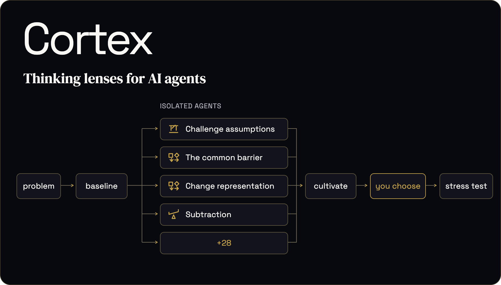
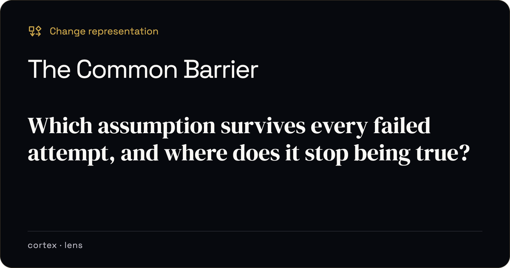
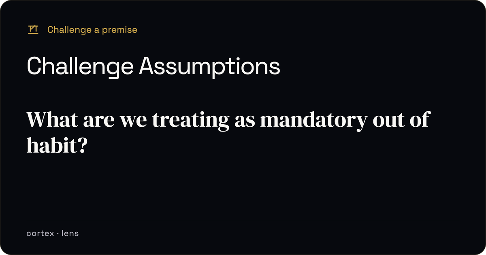
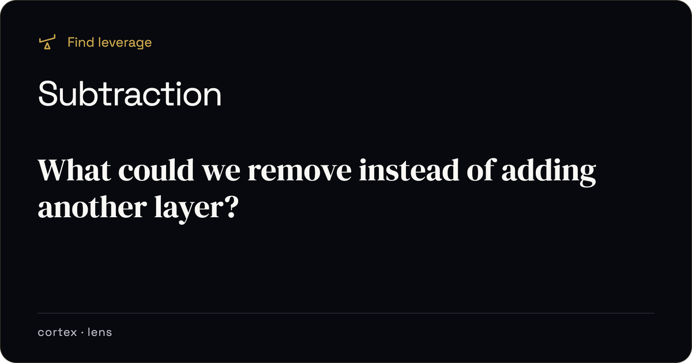
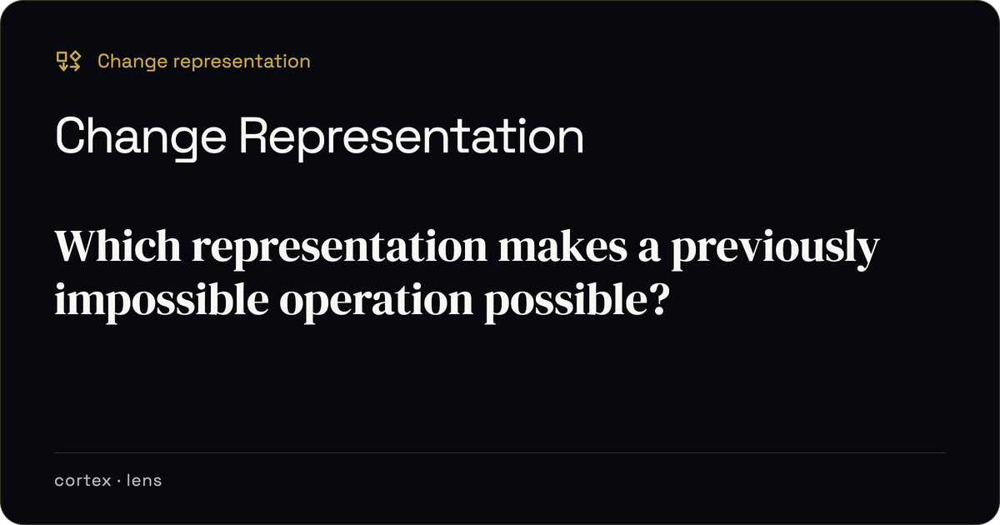
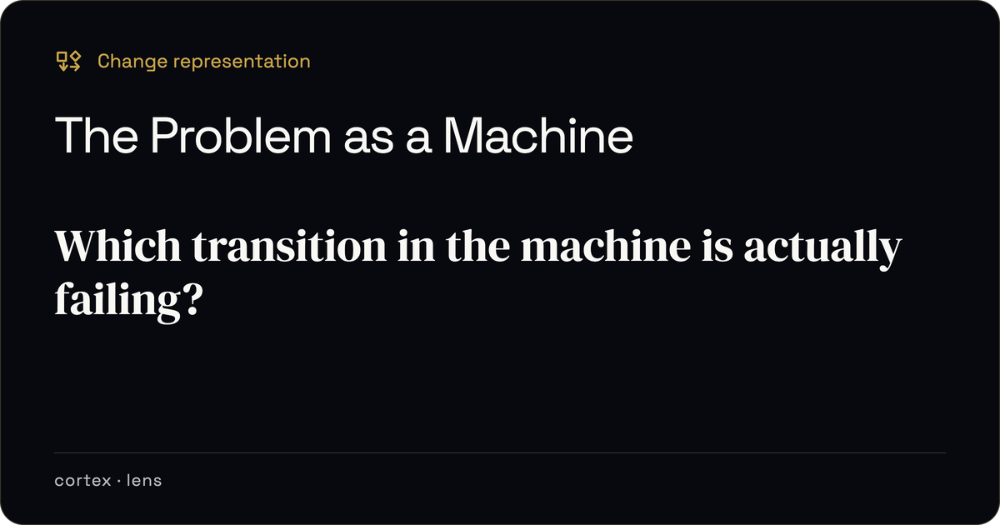
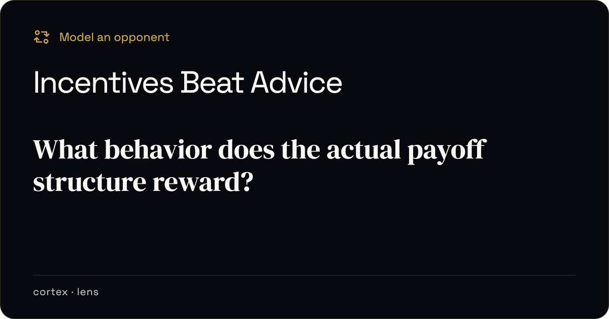
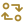
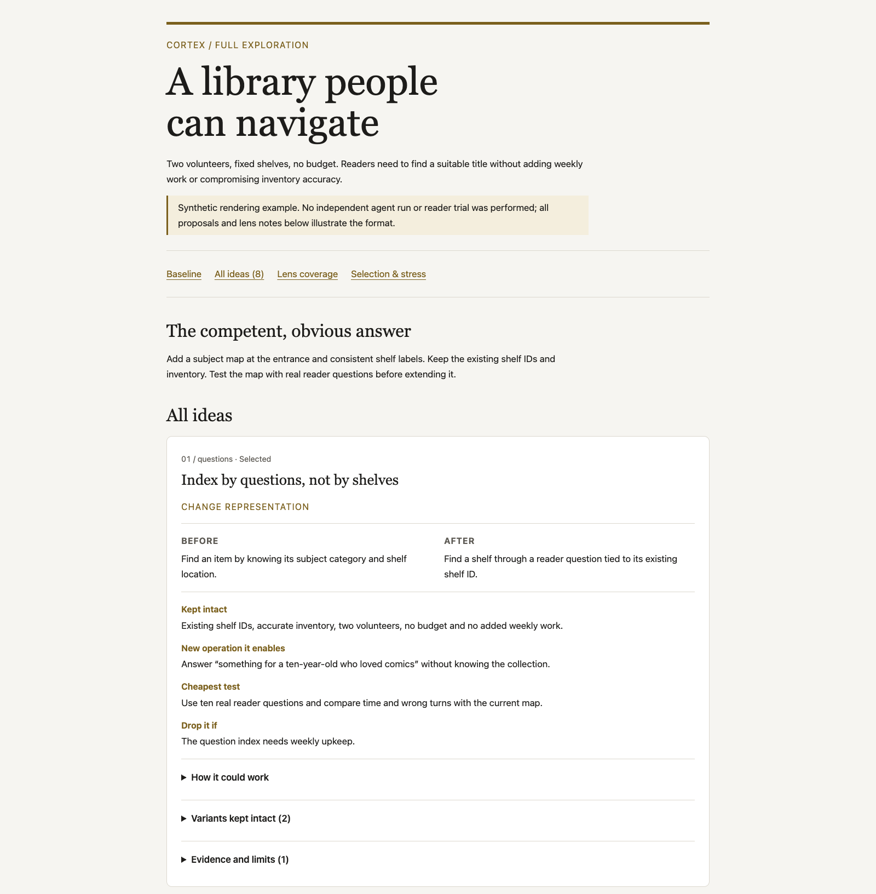

<p align="center">
  
</p>

<p align="center">
  
  
  
</p>

# Cortex: lateral thinking for AI agents

**Your agent's answer sounds sensible. But did it frame your problem, or just hand you the answer everyone else gets?**

Cortex is an agent skill for lateral thinking in Claude Code, Codex and OpenCode. It sends a hard problem through *thinking lenses*, short procedures such as "challenge the premise" or "subtract instead of adding", applied by agents that have never seen your draft; in the full mode, each lens gets an isolated agent of its own. What comes back are the ideas that could change your decision, each with the cheapest test that could prove it wrong.

Cortex is part of my research at [DL Frontier Lab](https://danilolapegna.com/en/lab).

[Italiano](README.it.md) · [Practical guide](https://danilolapegna.com/guides/cortex-lenses-agent-skills) · [The experiment](https://danilolapegna.com/en/lab/cortex-decisioni-piu-lucide)

## Why this

- **Because training rewards the straight line.** My reading of how models are trained today is that it rewards reaching the expected answer more than finding another way in. A strong hint: on math and code benchmarks, models trained with reinforcement learning on verifiable rewards win more often on the first try, yet their base models solve more problems when given many attempts ([Yue et al., NeurIPS 2025](https://arxiv.org/abs/2504.13837)). Sharper on the expected path, narrower around it.
- **Because everyone is starting to frame problems the same way.** Different models give strikingly similar answers to open questions, and the authors themselves worry about a long-term homogenization of human thought ([Artificial Hivemind, NeurIPS 2025](https://arxiv.org/abs/2510.22954)). When millions of people ask the same few assistants, the risk is not one bad answer: it is one way of representing problems for everybody.
- **Because framing comes before solving.** How you state a problem decides most of what can follow. Assistants are built to answer the question as asked and rarely stop to ask whether it is the right one. Almost half of the lenses work on the question, not on the answer.
- **Because sensible is not the same as right for you.** A reasonable answer is reasonable for the average case. Your team, your budget and your stakes are not average, and the move that fits them is rarely the most common one.
- **Because creativity is a set of moves, not a mood.** Questioning a premise, subtracting, borrowing a mechanism from another field, changing representation: these can be learned and run on purpose. Cortex writes them down, so an agent can apply them deliberately instead of waiting for a lucky phrasing.
- **Because the expensive mistakes happen before the work starts.** Building the wrong thing well takes weeks; a lens that questions the request takes a minute.
- **Because ideas are cheap now, and attention is not.** When a model can produce a hundred ideas in seconds, the scarce part is deciding which one deserves a test. Cortex keeps every idea, separates generating from judging and leaves the choice to you.
- **Because an idea without a test is just an opinion.** Every idea comes with the cheapest test that could prove it wrong and the condition for dropping it, so lateral thinking stays concrete and accountable.
- **Because thinking tools should be readable.** The lenses are plain Markdown: you can read them, argue with them, change them and add your own. No hidden prompt, no service, no lock-in.

## Why isolation matters

Ask one conversation for ten ideas and you get one idea in ten outfits: each answer leans on the ones before it. Cortex moves the starting point instead of the wording. In the full mode every lens gets a fresh agent that sees only the problem and its own procedure; the four lenses that work by transforming an answer also see the baseline. In the quick mode, a single agent that has never seen your draft applies three to five lenses.

Three design choices follow.

1. **A baseline comes first.** In the full mode, a separate agent writes the competent, obvious answer. Every idea is measured against it, and the question is never "is this clever?" but "would this change what you do?"
2. **One lens hunts for the shared assumption.** [The common barrier](skills/cortex/lenses/the-common-barrier.md) reads the baseline and the failed attempts, finds the assumption they all share and looks for the representation in which it stops being true. When a problem keeps resisting, the way out is often there.
3. **Generating and judging happen at different times.** Nothing is ranked or thrown away while ideas are produced. You see all of them on one page, and only the ones you pick are stress-tested.

## Two modes

| | Quick | Full |
|---|---|---|
| **Use it when** | You have an answer and want a second look before committing | The decision matters, or the problem has resisted two attempts |
| **What runs** | 3 to 5 lenses chosen for the problem, in one agent that has not seen your draft | The 24 core lenses plus any other that fits, each in its own agent, with sources checked where a claim depends on them |
| **What you get** | Your direct answer, then up to three ideas beside it | Every idea, developed into a testable proposal, on one page |
| **Cost** | One extra agent call | Dozens of calls: minutes and many more tokens |

Ask in plain words: *"use cortex quick on this"* or *"run a full cortex on this decision"*.

## A few of the lenses

<p align="center">
  <a href="skills/cortex/lenses/the-common-barrier.md"></a>
  <a href="skills/cortex/lenses/challenge-assumptions.md"></a>
  <a href="skills/cortex/lenses/subtraction.md"></a>
  <a href="skills/cortex/lenses/change-representation.md"></a>
  <a href="skills/cortex/lenses/the-problem-as-a-machine.md"></a>
  <a href="skills/cortex/lenses/incentives-beat-advice.md"></a>
</p>

There are 32 lenses in eleven families. You never have to pick them, because the agent chooses the ones that fit; each is also a short Markdown file you can read like a field guide or apply by hand.

| | Family | What it does | For example |
|---|---|---|---|
|  | Reframe | Restates the problem at a more useful level | [Ladder of whys](skills/cortex/lenses/ladder-of-whys.md) |
|  | Challenge a premise | Tests what everyone takes for granted | [Remove the ritual](skills/cortex/lenses/remove-the-ritual.md) |
|  | Transfer a mechanism | Borrows a working solution from a distant field | [The core verb](skills/cortex/lenses/the-core-verb.md) |
|  | Change representation | Gives the problem a form that enables a new operation | [The problem as a machine](skills/cortex/lenses/the-problem-as-a-machine.md) |
|  | Find leverage | Looks for the small change with the large effect | [The ordinary fix](skills/cortex/lenses/the-ordinary-fix.md) |
|  | Generate | Produces many options in a structured way | [Morphological matrix](skills/cortex/lenses/morphological-matrix.md) |
|  | Verify | Turns an objection into evidence you can collect | [Testable dissent](skills/cortex/lenses/testable-dissent.md) |
|  | Decide | Chooses while keeping options open | [Optionality](skills/cortex/lenses/optionality.md) |
|  | Model an opponent | Predicts how others will respond | [Opponent response](skills/cortex/lenses/opponent-response.md) |
|  | Manage uncertainty | Plans for what you cannot know yet | [Base rates](skills/cortex/lenses/base-rates-and-the-right-reference-class.md) |
|  | Reverse a disadvantage | Turns a weakness into an asset | [Reverse a disadvantage](skills/cortex/lenses/reverse-a-disadvantage.md) |

## What an idea looks like

Every idea comes back in the same shape, so you can tell in seconds whether it deserves a test. Here is an illustrative card for a volunteer library whose readers cannot find books; the whole case is in [examples/library.md](examples/library.md).

| **Index by questions, not by shelves** | *lens: change representation* |
|---|---|
| **Before** | A book is found through its location |
| **After** | Through the questions readers actually ask, each pointing to the same shelf ID |
| **Kept intact** | Inventory accuracy; no extra weekly work |
| **New operation** | Answering *"something for a ten-year-old who loved comics"* without knowing the collection |
| **Cheapest test** | Ten real reader questions: time to the right shelf with the current map and with the question index |
| **Drop it if** | The index needs weekly upkeep |

A change of representation counts only when it enables an operation that was impossible before; renaming the problem is not enough. In the full mode, all the cards land on a single page:

<p align="center">
  
</p>

Open [examples/full-run.html](examples/full-run.html) in a browser to explore it, including the follow-up in which two chosen ideas meet the stress checks.

## Where it earns its keep

These scenes are illustrative; the measured result follows.

- **Before you build.** *"We need an agent to answer customer email: there is too much of it."* A premise lens asks why the email arrives at all. Alternative: fix the instructions that produce the repeated questions. Test: classify fifty recent requests before writing any code.
- **Research that keeps failing.** *"Three experiments in a row came back null."* Before a fourth is designed, [the common barrier](skills/cortex/lenses/the-common-barrier.md) looks for the assumption the three share, and [base rates](skills/cortex/lenses/base-rates-and-the-right-reference-class.md) asks how often truly comparable experiments come back null, and how comparable they really are.
- **A bug that survived two fixes.** [The problem as a machine](skills/cortex/lenses/the-problem-as-a-machine.md) redraws the system as inputs, transformations and outputs, to find the step every failed fix assumed was working.
- **A strategic bet.** *"Should we enter this market now?"* [Opponent response](skills/cortex/lenses/opponent-response.md) asks how an informed competitor would adapt to your entry; [scenarios](skills/cortex/lenses/scenarios-and-robust-strategies.md) looks for a first move that holds up in more than one future.
- **A thesis before you publish it.** [Testable dissent](skills/cortex/lenses/testable-dissent.md) writes the strongest objection to your argument and names the evidence that would settle it.

## What we measured

At DL Frontier Lab we froze twelve new cases before generating any answer and compared three conditions with the same model: the model on its own, a generic review with a comparable budget, and Cortex. On the six hardest, open problems, the ones the full mode is built for, two blind judges preferred Cortex to the model's own answer 6 times out of 6. Against the generic review, Cortex had 4 wins and 2 ties, with no losses. Six cases are evidence, not a guarantee, and the full mode takes noticeably longer. [Read the experiment](https://danilolapegna.com/en/lab/cortex-decisioni-piu-lucide).

## Install

You need an agent host that can start separate agents (subagents). Copy the skill folder into the host's skills directory:

| Host | In a project | For all your projects |
|---|---|---|
| Claude Code | `.claude/skills/` | `~/.claude/skills/` |
| Codex | `.agents/skills/` | `~/.agents/skills/` |
| OpenCode | `.opencode/skills/` | `~/.config/opencode/skills/` |

```bash
git clone https://github.com/danilolapegna/cortex-lenses
mkdir -p .claude/skills && cp -r cortex-lenses/skills/cortex .claude/skills/
```

The skill is plain instructions and Markdown; Python 3.10+ is needed only for the optional page of a full run and for the lens check. Open a new session and try:

> A volunteer library has its existing shelves, two volunteers and no budget. Readers struggle to find books. Use cortex quick to make books easier to find without adding weekly work.

## Anatomy of a lens

```text
skills/cortex/
├── SKILL.md      when to use it and how the two modes run
├── quick.md      the quick mode, step by step
├── full.md       the full mode, step by step
├── lenses/       32 lenses, one Markdown file each
├── checks/       10 checks that stress-test an idea you chose
└── scripts/      optional: render a full run as one page, validate the lenses
```

A lens is a question, a few steps and two conditions. This is the whole file for the common barrier:

```markdown
---
name: "The Common Barrier"
family: "change-representation"
core: true
question: "Which assumption survives every failed attempt, and where does it stop being true?"
---

# The Common Barrier

Find a new representation that escapes the shared barrier without weakening the goal.

## Steps

1. Read the independent baseline and the supplied failed attempts.
2. Show the same assumption inside each attempt; do not invent a failure history.
3. Freeze the objective dimensions that must remain intact.
4. Construct a before/after representation where the assumption is unnecessary.
5. Name the newly possible operation and a cheap test that could disprove it.

## Use it when

Different attempts fail while preserving the same model of the problem.

## Leave it out when

The failure has one known cause with a validated repair.
```

To add your own, write a file in the same shape in `lenses/` and validate it from the root of the cloned repository:

```bash
cd cortex-lenses && python3 skills/cortex/scripts/check.py
```

## Limits, stated plainly

- Cortex calls no model itself: your host does, with its usual costs and data handling. Keep confidential material out of the problem you share.
- It does not decide for you. An idea is a proposal to test, never permission to act.
- If your host cannot run separate agents, the skill says so and labels its ideas as not independent.

## License

MIT · Danilo Lapegna
